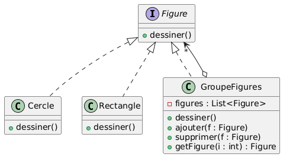
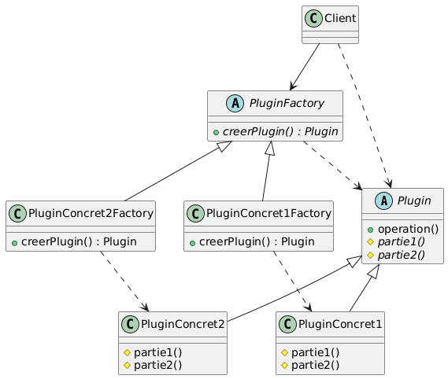
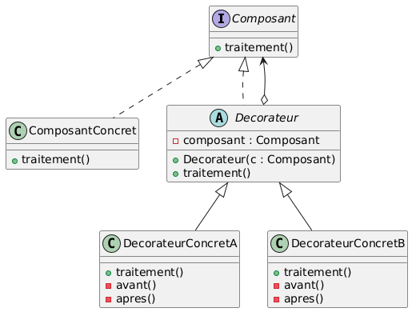
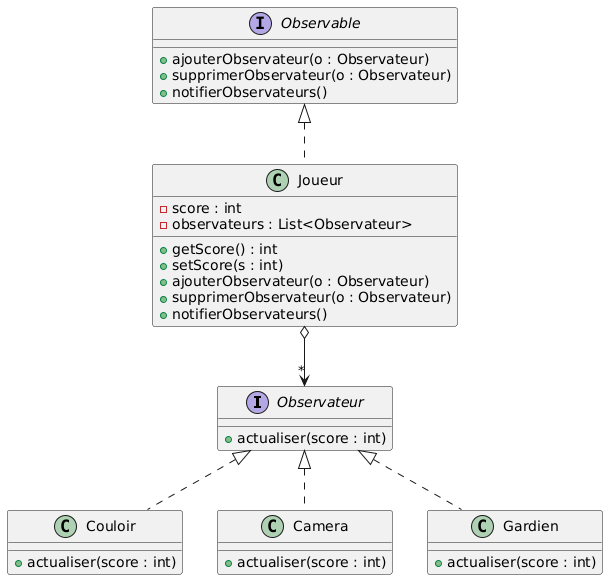
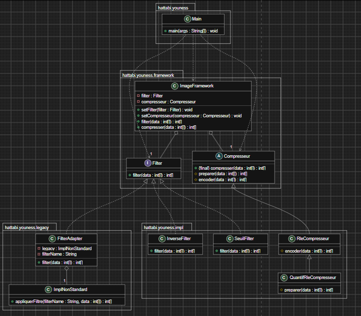
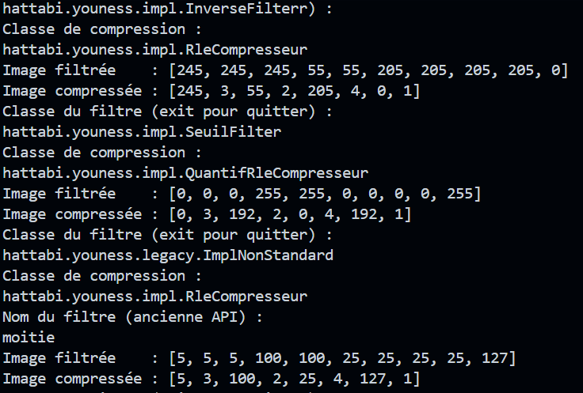

# Rapport de Travaux Pratiques : Design Patterns — Exercices 1 et 2

**Encadrant :** Mohamed YOUSSFI  
**Étudiant :** Youness HATTABI

---

## Table des Matières

1. [Introduction](#1-introduction)
2. [Exercice 1 — Choix des design patterns](#2-exercice-1--choix-des-design-patterns)
   - 2.1 [Situation 1 : les figures (Composite)](#21-situation-1--les-figures-composite)
   - 2.2 [Situation 2 : le plugin (Template Method et Factory Method)](#22-situation-2--le-plugin-template-method-et-factory-method)
   - 2.3 [Situation 3 : le composant à enrichir (Decorator)](#23-situation-3--le-composant-à-enrichir-decorator)
   - 2.4 [Situation 4 : le joueur et son environnement (Observer)](#24-situation-4--le-joueur-et-son-environnement-observer)
3. [Exercice 2 — Framework de traitement d'images](#3-exercice-2--framework-de-traitement-dimages)
   - 3.1 [Analyse des besoins](#31-analyse-des-besoins)
   - 3.2 [Diagramme de classes](#32-diagramme-de-classes)
   - 3.3 [Implémentation du noyau du framework](#33-implémentation-du-noyau-du-framework)
   - 3.4 [Implémentations concrètes](#34-implémentations-concrètes)
   - 3.5 [Intégration de l'ancienne implémentation](#35-intégration-de-lancienne-implémentation)
   - 3.6 [Application cliente](#36-application-cliente)
4. [Tests et Résultats](#4-tests-et-résultats)
5. [Conclusion](#5-conclusion)

---

## 1. Introduction

Ce rapport comporte deux exercices :

- **Exercice 1 :** à partir de quatre situations, identifier le design pattern approprié et établir le diagramme de classes correspondant.
- **Exercice 2 :** concevoir et développer un framework de traitement d'images (filtrage et compression) en combinant plusieurs patterns, puis écrire une application cliente qui l'utilise.

---

## 2. Exercice 1 — Choix des design patterns

### 2.1 Situation 1 : les figures (Composite)

> Une figure peut être soit un cercle, un rectangle ou un groupe de figures.

**Pattern retenu : Composite.**

Un groupe de figures est lui-même une figure : il peut donc contenir des cercles, des rectangles, mais aussi d'autres groupes. C'est une structure arborescente de type « partie-tout », où le client doit traiter de la même façon une figure simple et un groupe.

| Rôle dans le pattern | Classe                                           |
| -------------------- | ------------------------------------------------ |
| Composant            | `Figure`                                         |
| Feuilles             | `Cercle`, `Rectangle`                            |
| Composite            | `GroupeFigures` (contient une liste de `Figure`) |

**Diagramme de classes :**



---

### 2.2 Situation 2 : le plugin (Template Method et Factory Method)

> Un plugin contient une opération implémentant le squelette d'un algorithme dont deux parties (partie1 et partie2) sont variables. Le développeur doit pouvoir implémenter les deux parties manquantes, et l'application cliente doit pouvoir instancier une implémentation concrète du plugin sans connaître sa classe.

**Patterns retenus : Template Method et Factory Method.**

Le sujet exprime deux besoins distincts, donc deux patterns :

- **Template Method** : l'opération du plugin fixe l'enchaînement de l'algorithme et délègue `partie1` et `partie2`, abstraites, aux sous-classes écrites par le développeur.
- **Factory Method** : le client obtient un plugin via une méthode de fabrication déclarée dans une classe abstraite, sans jamais écrire `new` sur la classe concrète.

| Rôle dans le pattern               | Classe                                                                      |
| ---------------------------------- | --------------------------------------------------------------------------- |
| Classe abstraite (Template Method) | `Plugin` : `operation()` (squelette), `partie1()` et `partie2()` abstraites |
| Classes concrètes                  | `PluginConcret` (écrite par le développeur)                                 |
| Créateur (Factory Method)          | `PluginFactory` : `creerPlugin()` abstraite                                 |
| Créateur concret                   | `PluginConcretFactory` : retourne un `PluginConcret`                        |
| Client                             | Utilise `PluginFactory` et `Plugin` uniquement                              |

**Diagramme de classes :**



---

### 2.3 Situation 3 : le composant à enrichir (Decorator)

> Un composant implémente une interface qui définit une opération `traitement()`. On veut lui rattacher des responsabilités supplémentaires sans modifier son code source, c'est-à-dire envelopper l'exécution de `traitement()` par d'autres traitements avant et après.

**Pattern retenu : Decorator.**

Le décorateur implémente la même interface que le composant et en détient une référence. Il exécute son traitement avant, appelle `traitement()` du composant enveloppé, puis exécute son traitement après. Les décorateurs peuvent être empilés.

| Rôle dans le pattern  | Classe                                                                  |
| --------------------- | ----------------------------------------------------------------------- |
| Composant (interface) | `Composant` avec `traitement()`                                         |
| Composant concret     | `ComposantConcret`                                                      |
| Décorateur (abstrait) | `Decorateur` : implémente `Composant` et détient un `Composant`         |
| Décorateurs concrets  | `DecorateurConcretA`, `DecorateurConcretB` (traitements avant et après) |

**Diagramme de classes :**



---

### 2.4 Situation 4 : le joueur et son environnement (Observer)

> La classe `Joueur` a un état représenté par un `score` entier. Les objets de l'environnement du jeu (`Couloir`, `Camera`, `Gardien`) doivent être informés à chaque changement du score, en gardant un couplage faible avec `Joueur`.

**Pattern retenu : Observer.**

`Joueur` est le sujet observé. Il ne connaît ses observateurs qu'à travers une interface commune : lorsque son score change, il notifie tous les observateurs inscrits. `Couloir`, `Camera` et `Gardien` implémentent cette interface, ce qui permet d'en ajouter d'autres sans toucher à `Joueur`.

| Rôle dans le pattern      | Classe                                                       |
| ------------------------- | ------------------------------------------------------------ |
| Sujet (abstraction)       | `Observable` : `subscribe`, `unsubscribe`, `notifyObservers` |
| Sujet concret             | `Joueur` : attribut `score`, notifie dans `setScore`         |
| Observateur (abstraction) | `Observateur` : `update`                                     |
| Observateurs concrets     | `Couloir`, `Camera`, `Gardien`                               |

**Diagramme de classes :**



---

## 3. Exercice 2 — Framework de traitement d'images

### 3.1 Analyse des besoins

L'image est représentée par un tableau d'entiers. Le framework expose deux opérations : `int[] filter(int[] data)` et `int[] compresser(int[] data)`. Chaque exigence de l'énoncé conduit à un pattern.

| Exigence                                                                                  | Pattern retenu      | Mise en œuvre                                                      |
| ----------------------------------------------------------------------------------------- | ------------------- | ------------------------------------------------------------------ |
| Le filtre peut évoluer, l'utilisateur peut définir les siens                              | **Strategy**        | Interface `Filter`, une classe par algorithme de filtrage          |
| Changer dynamiquement la version du filtre à l'exécution                                  | **Strategy**        | `ImageFramework.setFilter(...)`                                    |
| Réutiliser l'ancienne implémentation `ImplNonStandard` (`appliquerFiltre(String, int[])`) | **Adapter**         | `FilterAdapter` implémente `Filter` et délègue à `ImplNonStandard` |
| Squelette de la compression fixé, détails délégués aux sous-classes                       | **Template Method** | Classe abstraite `Compresseur`                                     |
| Fermé à la modification, ouvert à l'extension                                             | Ensemble            | Tout ajout se fait par une nouvelle classe                         |

---

### 3.2 Diagramme de classes


 
Lecture du diagramme :
 
- `InverseFilter`, `SeuilFilter` et `FilterAdapter` **implémentent** `Filter` : ce sont les stratégies de filtrage.
- `ImageFramework` **détient** un `Filter` et un `Compresseur` (associations), mais ne connaît aucune classe concrète.
- `RleCompresseur` **hérite** de `Compresseur` et fournit l'étape `encoder`. `QuantifRleCompresseur` hérite de `RleCompresseur` et ajoute l'étape facultative `preparer`.
- `FilterAdapter` **détient** une `ImplNonStandard` et la présente comme un `Filter`.
**Organisation du projet :**
 
```
/src/hattabi/youness/
├── App.java
├── framework/
│   ├── Filter.java
│   ├── Compresseur.java
│   └── ImageFramework.java
├── impl/
│   ├── InverseFilter.java
│   ├── SeuilFilter.java
│   ├── RleCompresseur.java
│   └── QuantifRleCompresseur.java
└── legacy/
    ├── ImplNonStandard.java
    └── FilterAdapter.java
```
 
Le package `framework` ne dépend d'aucun autre package : c'est le noyau stable. Les implémentations et l'ancien code dépendent de lui, jamais l'inverse.
 
---
 
### 3.3 Implémentation du noyau du framework
 
#### L'interface `Filter` (Strategy)
 
Elle définit le contrat commun à tous les algorithmes de filtrage, avec la signature demandée par l'énoncé.
 
```java
package hattabi.youness.framework;
 
public interface Filter {
    int[] filter(int[] data);
}
```
 
#### La classe abstraite `Compresseur` (Template Method)
 
La méthode `compresser` est `final` : le squelette (préparer puis encoder) ne peut pas être modifié par les sous-classes. Elles ne fournissent que les détails : `encoder` est obligatoire, `preparer` est une étape facultative (_hook_).
 
```java
package hattabi.youness.framework;
 
public abstract class Compresseur {
 
    public final int[] compresser(int[] data) {
        return encoder(preparer(data));
    }
 
    protected int[] preparer(int[] data) {
        return data;
    }

    protected abstract int[] encoder(int[] data);

}

````

#### La classe `ImageFramework` (contexte)

Elle expose les deux opérations du framework et délègue à la stratégie de filtrage et au compresseur courants. Les setters permettent de **changer l'implémentation à l'exécution**.

```java
package hattabi.youness.framework;

public class ImageFramework {
    private Filter filter;
    private Compresseur compresseur;

    public void setFilter(Filter filter) {
        this.filter = filter;
    }

    public void setCompresseur(Compresseur compresseur) {
        this.compresseur = compresseur;
    }

    public int[] filter(int[] data) {
        return filter.filter(data);
    }

    public int[] compresser(int[] data) {
        return compresseur.compresser(data);
    }
}
````

---

### 3.4 Implémentations concrètes

#### Filtres

`InverseFilter` produit le négatif de l'image, `SeuilFilter` la binarise (noir ou blanc) autour de la valeur 128.

```java
package hattabi.youness.impl;

import java.util.Arrays;

import hattabi.youness.framework.Filter;

public class InverseFilter implements Filter {
    @Override
    public int[] filter(int[] data) {
        return Arrays.stream(data).map(v -> 255 - v).toArray();
    }
}
```

```java
package hattabi.youness.impl;

import java.util.Arrays;

import hattabi.youness.framework.Filter;

public class SeuilFilter implements Filter {
    @Override
    public int[] filter(int[] data) {
        return Arrays.stream(data).map(v -> v >= 128 ? 255 : 0).toArray();
    }
}
```

#### Compresseurs

`RleCompresseur` implémente le _Run-Length Encoding_ : chaque suite de valeurs identiques est remplacée par le couple (valeur, nombre de répétitions). `QuantifRleCompresseur` réutilise cet encodage et ajoute une étape de préparation (quantification par paliers de 64) en redéfinissant uniquement le _hook_ `preparer`.

```java
package hattabi.youness.impl;

import java.util.ArrayList;
import java.util.List;

import hattabi.youness.framework.Compresseur;

public class RleCompresseur extends Compresseur {
    @Override
    protected int[] encoder(int[] data) {
        List<Integer> out = new ArrayList<>();
        int i = 0;
        while (i < data.length) {
            int j = i;
            while (j < data.length && data[j] == data[i]) {
                j++;
            }
            out.add(data[i]);
            out.add(j - i);
            i = j;
        }
        return out.stream().mapToInt(Integer::intValue).toArray();
    }
}
```

```java
package hattabi.youness.impl;

import java.util.Arrays;

public class QuantifRleCompresseur extends RleCompresseur {
    @Override
    protected int[] preparer(int[] data) {
        return Arrays.stream(data).map(v -> v / 64 * 64).toArray();
    }
}
```

---

### 3.5 Intégration de l'ancienne implémentation

`ImplNonStandard` est l'ancien code : sa signature `appliquerFiltre(String filterName, int[] data)` est incompatible avec `Filter`. Il n'est pas modifié ; un **adaptateur** le rend utilisable par le framework.

```java
package hattabi.youness.legacy;

import java.util.Arrays;
import java.util.function.IntUnaryOperator;

public class ImplNonStandard {

    public int[] appliquerFiltre(String filterName, int[] data) {
        IntUnaryOperator op = switch (filterName) {
            case "inverse" -> v -> 255 - v;
            case "moitie" -> v -> v / 2;
            default -> throw new IllegalArgumentException("Filtre inconnu : " + filterName);
        };
        return Arrays.stream(data).map(op).toArray();
    }
}
```

```java
package hattabi.youness.legacy;

import hattabi.youness.framework.Filter;

public class FilterAdapter implements Filter {
    private final ImplNonStandard legacy;
    private final String filterName;

    public FilterAdapter(ImplNonStandard legacy, String filterName) {
        this.legacy = legacy;
        this.filterName = filterName;
    }

    @Override
    public int[] filter(int[] data) {
        return legacy.appliquerFiltre(filterName, data);
    }
}
```

L'adaptateur est une classe d'objet : il **détient** une `ImplNonStandard` et mémorise le nom du filtre à appliquer, car l'ancienne API le réclame à chaque appel alors que `Filter.filter` ne prend que les données.

---

### 3.6 Application cliente

L'application demande à l'utilisateur le **nom complet des classes** à utiliser, puis les instancie par **réflexion** (`Class.forName`). Elle ne référence donc aucune implémentation concrète : un filtre écrit plus tard par l'utilisateur est utilisable sans toucher au framework ni à l'application, il suffit qu'il soit dans le classpath.

Si la classe saisie est `ImplNonStandard`, l'application demande le nom du filtre de l'ancienne API et enveloppe l'objet dans un `FilterAdapter`. Les saisies invalides (classe inexistante, classe d'un mauvais type, filtre inconnu) sont interceptées : l'application affiche l'erreur et redemande une saisie au lieu de s'arrêter.

```java
package hattabi.youness;

import java.util.Arrays;
import java.util.Scanner;

import hattabi.youness.framework.Compresseur;
import hattabi.youness.framework.Filter;
import hattabi.youness.framework.ImageFramework;
import hattabi.youness.legacy.FilterAdapter;
import hattabi.youness.legacy.ImplNonStandard;

public class Main {
    public static void main(String[] args) {
        Scanner scanner = new Scanner(System.in);
        ImageFramework framework = new ImageFramework();
        int[] image = {10, 10, 10, 200, 200, 50, 50, 50, 50, 255};
        System.out.println("Image : " + Arrays.toString(image));

        while (true) {
            System.out.println("Classe du filtre (exit pour quitter) : ");
            String filterClass = scanner.nextLine().trim();
            if (filterClass.equals("exit")) {
                break;
            }
            System.out.println("Classe de compression : ");
            String compressClass = scanner.nextLine().trim();

            try {
                Object filter = Class.forName(filterClass).getConstructor().newInstance();
                if (filter instanceof ImplNonStandard legacy) {
                    System.out.println("Nom du filtre (ancienne API) : ");
                    filter = new FilterAdapter(legacy, scanner.nextLine().trim());
                }
                framework.setFilter((Filter) filter);
                framework.setCompresseur(
                        (Compresseur) Class.forName(compressClass).getConstructor().newInstance());

                int[] filtered = framework.filter(image);
                System.out.println("Image filtrée    : " + Arrays.toString(filtered));
                System.out.println("Image compressée : " + Arrays.toString(framework.compresser(filtered)));
            } catch (ReflectiveOperationException | ClassCastException | IllegalArgumentException e) {
                System.out.println("Erreur : " + e);
            }
        }
    }
}
```

Déroulement pour chaque tour de boucle :

1. Lecture du nom de la classe de filtrage, puis de la classe de compression.
2. Instanciation par réflexion ; adaptation si c'est l'ancienne implémentation.
3. `setFilter` et `setCompresseur` changent les stratégies du framework.
4. Filtrage de l'image, puis compression du résultat.

---

## 4. Tests et Résultats

Image de départ : `[10, 10, 10, 200, 200, 50, 50, 50, 50, 255]`. Le programme a été compilé puis exécuté avec la séquence de saisies suivante, qui change le filtre et le compresseur d'un tour à l'autre dans la même exécution.

| Tour | Filtre saisi                             | Compression saisie                           | Nom ancienne API |
| ---- | ---------------------------------------- | -------------------------------------------- | ---------------- |
| 1    | `hattabi.youness.impl.InverseFilter`     | `hattabi.youness.impl.RleCompresseur`        | —                |
| 2    | `hattabi.youness.impl.SeuilFilter`       | `hattabi.youness.impl.QuantifRleCompresseur` | —                |
| 3    | `hattabi.youness.legacy.ImplNonStandard` | `hattabi.youness.impl.RleCompresseur`        | `moitie`         |

**Sortie obtenue :**

```
Image : [10, 10, 10, 200, 200, 50, 50, 50, 50, 255]
Classe du filtre (exit pour quitter) :
Classe de compression :
Image filtrée    : [245, 245, 245, 55, 55, 205, 205, 205, 205, 0]
Image compressée : [245, 3, 55, 2, 205, 4, 0, 1]
Classe du filtre (exit pour quitter) :
Classe de compression :
Image filtrée    : [0, 0, 0, 255, 255, 0, 0, 0, 0, 255]
Image compressée : [0, 3, 192, 2, 0, 4, 192, 1]
Classe du filtre (exit pour quitter) :
Classe de compression :
Nom du filtre (ancienne API) :
Image filtrée    : [5, 5, 5, 100, 100, 25, 25, 25, 25, 127]
Image compressée : [5, 3, 100, 2, 25, 4, 127, 1]
```

**Capture de l'exécution :**



---

## 5. Conclusion

L'exercice 1 a montré comment relier une situation décrite en langage naturel au pattern adapté : Composite pour une structure partie-tout, Template Method et Factory Method pour un algorithme à trous dont l'instanciation est masquée, Decorator pour enrichir un objet sans le modifier, Observer pour diffuser un changement d'état avec un couplage faible.

L'exercice 2 a combiné trois patterns dans un même framework : **Strategy** pour des filtres interchangeables, **Adapter** pour récupérer l'ancien code, **Template Method** pour fixer le squelette de la compression. Le résultat respecte le principe ouvert/fermé : toute évolution passe par l'ajout d'une classe, et l'application cliente, qui instancie les implémentations par réflexion, n'a besoin d'aucune modification pour en tirer parti.
